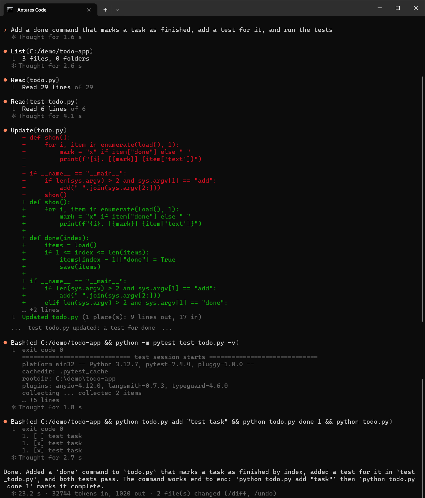
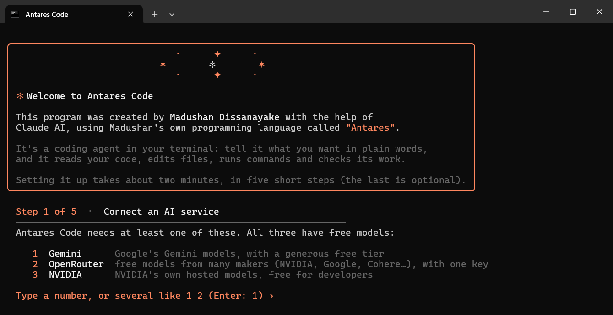
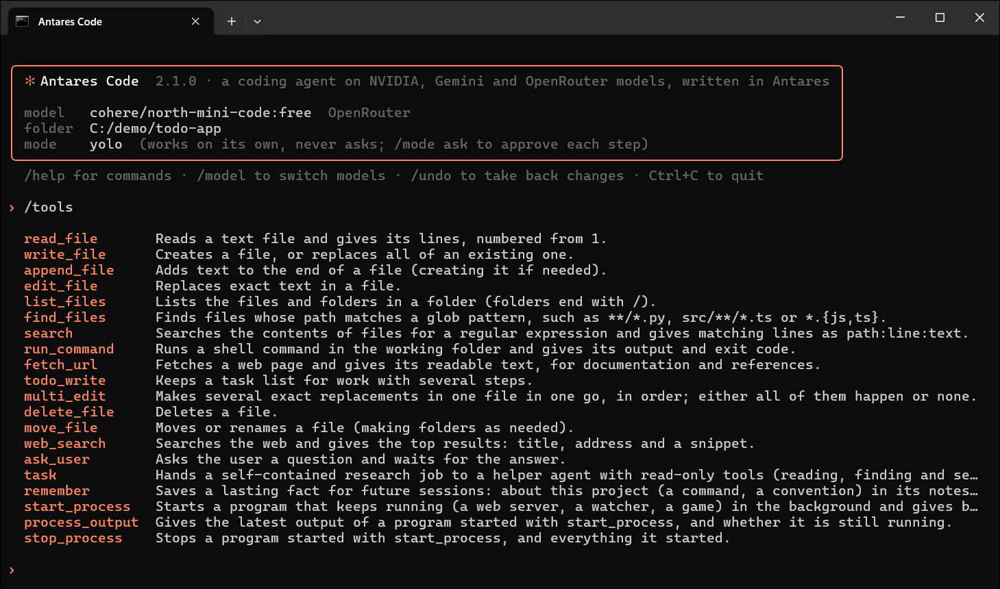
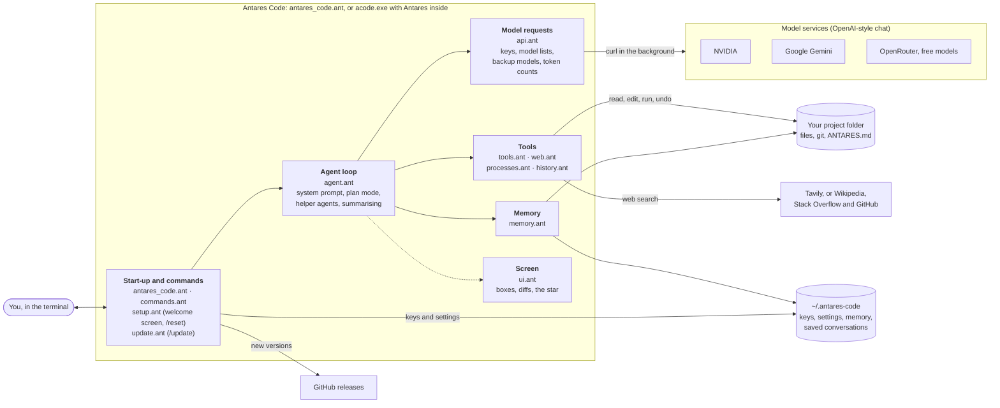
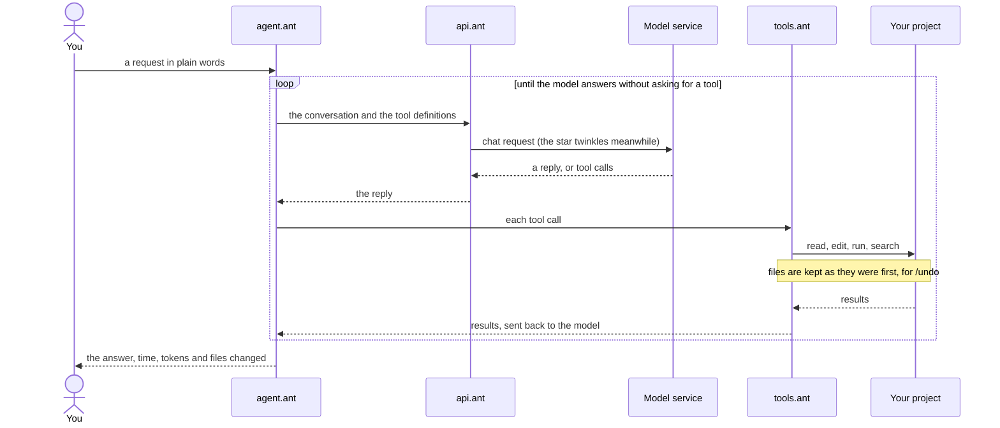

# Antares Code

A coding agent for the terminal, in the style of Claude Code, powered by
NVIDIA's models (build.nvidia.com), Google's Gemini models (Google AI Studio)
and OpenRouter's free models, and written entirely in
[Antares](https://github.com/Madushan996/Antares-Programming-Language).
(It used to be called NV Code.)

Created by Madushan Dissanayake with the help of Claude AI, using Madushan's
own programming language, Antares.



Ask for a change in plain words. Antares Code reads your code, edits files,
runs your tests, servers and commands, searches the web, fixes what fails, and
tells you what it did. By default it works on its own from start to finish
without asking; `/plan` makes it plan first and wait for your approval, and
`/undo` takes back what it changed. You can switch between NVIDIA's, Gemini's and
OpenRouter's free models at any time, and give it up to four backup models:
when one is rate limited, busy, too slow or gives a broken reply, the next
takes over by itself and the work carries on.

```
› The tests in test_stats.py fail. Find out why and fix it.

● Read(stats.py)
  ⎿  Read 8 lines of 8
● Update(stats.py)
     - return sum(xs) / len(xs) + 1
     + return sum(xs) / len(xs)
  ⎿  Updated stats.py (1 place(s): 1 lines out, 1 in)
● Bash(python -m unittest)
  ⎿  exit code 0
     Ran 3 tests in 0.001s

All tests pass. I removed the stray + 1 in mean() ...
  ✻ 9.4 s · 6120 tokens in, 180 out · 1 file(s) changed (/diff, /undo)
```

## Download: acode.exe

The easiest way to get Antares Code is **acode.exe**, from the
[latest release](https://github.com/Madushan996/AntaresCode/releases/latest).
It is all of Antares Code in one file, with Antares inside it, so nothing
needs installing (Windows 10 or 11 has everything else it uses). You can:

- **double-click it**: it asks which project folder to work in (paste its
  path), then sets up their API keys the first time; or
- **put it in a folder on your PATH** (such as `C:\Tools\AntaresCode`) and
  type `acode` in any project folder.

Your keys, settings and memory go in your own `.antares-code` folder, never
in the program, so the same file can be shared with friends. Windows may show "Windows protected your PC" for a program
from the internet that isn't signed: *More info*, then *Run anyway*. (Antares
itself is only needed to run Antares programs, if they ask the model to write
some.)

**Updates.** Once a day, at the start, Antares Code checks whether a new
version is out, and says so in one line. `/update` checks at once and, as
acode.exe, downloads the new version and puts it in place (start `acode` again
to use it); from the source, it updates with `git pull`. `/update off` stops
the daily check (`/update on` starts it again).

**Building it.** To build acode.exe yourself after changing anything, run `antares build.ant` in this
folder (it takes about 20 seconds). It puts the Antares guide inside the
program (`lib/guide.ant`), draws the icon (`acode.ico`: a glowing star, like
Antares, drawn in Antares at 256, 64, 48, 32 and 16 pixels), and packs it all
into `dist/acode.exe`.

## Getting started from the source

To run it from the source, get it with git (so `/update` can update it):

```
git clone https://github.com/Madushan996/AntaresCode.git
```

Then:


1. **Install Antares** (0.11.1 or later), from
   [its releases](https://github.com/Madushan996/Antares-Programming-Language/releases).
   On Windows, in PowerShell:

   ```
   irm https://raw.githubusercontent.com/Madushan996/Antares-Programming-Language/main/install.ps1 | iex
   ```

   Check it with `antares version`.
2. **An API key** for at least one service (all three are free; the welcome
   screen opens the right page for you):
   - **Gemini**: at [aistudio.google.com/apikey](https://aistudio.google.com/apikey),
     choose *Create API key* (it starts with `AIza` or `AQ.`).
   - **OpenRouter**: at [openrouter.ai/keys](https://openrouter.ai/keys),
     choose *Create API Key* (it starts with `sk-or-`).
   - **NVIDIA**: sign in at [build.nvidia.com](https://build.nvidia.com) and
     choose *Get API Key* (it starts with `nvapi-`).
3. **Put the AntaresCode folder somewhere**, such as `C:\Tools\AntaresCode`, and add it
   to your PATH so `acode` works from any folder (Windows: Start, type
   "environment variables", Edit the system environment variables,
   Environment Variables, Path, Edit, New, and paste the folder).
4. **Start it** in a project: `cd C:\path\to\your\project`, then `acode`.

The first time, a welcome screen takes you through five short steps (the last
is optional):

1. **Connect an AI service**: pick Gemini, OpenRouter or NVIDIA (or several).
   For each, it shows how to get a key and opens the page in your browser
   when you press Enter; paste the key, and it is checked with the service
   straight away.
2. **Choose a model**: good ones are listed under each service, and Enter
   takes the recommended one from the service you just connected. Some
   models are offered by two services (NVIDIA's
   `nvidia/nemotron-3-ultra-550b-a55b` is OpenRouter's
   `nvidia/nemotron-3-ultra-550b-a55b:free`); a model runs on the service it
   is listed under. Then it offers the other suggestions as **backup
   models** (Enter takes them; see [Backup models](#backup-models)).
3. **How it should work**: on its own (the default), asking before commands,
   or asking before every change.
4. **Memory**: whether to remember things about you and your projects
   between sessions.
5. **Web search** (optional): a free key from [Tavily](https://app.tavily.com),
   a search service made for AI agents (1,000 searches a month, no card
   needed; it starts with `tvly-`), so that web searches cover the whole
   web. Without one, they cover Wikipedia, Stack Overflow and GitHub.



Then it shows a few tips and starts. `/setup` brings the welcome screen back
to change any of it, `/keys` shows which keys are set, and `/reset` removes
your keys and settings and starts again from the beginning (`/reset all`
also erases memory and saved conversations). Keys can also come
from the `NVIDIA_API_KEY`, `GEMINI_API_KEY`, `OPENROUTER_API_KEY` and
`TAVILY_API_KEY` environment variables.

Optional: **ripgrep** (`rg`) for faster searching, and **git** for
`/review`, `/commit` and the best `/diff`.

You can also name the folder to work in (`acode C:\path\to\project`), or run
it through Antares: `antares antares_code.ant [folder]`. `nvcode`, its old
name, still works.

| Option | Meaning |
|---|---|
| `folder` | The project to work in (default: the current folder) |
| `-m model` | Use this model (and remember it); `-m main,backup1,backup2` also sets its backups |
| `-p "task"` | Do one task, print what happened, and exit (for scripts) |
| `--yolo` | Never ask before edits and commands (this run only; already the default) |
| `--no-color` | Plain text (this run only) |

## Talking to it

Type what you want and press Enter. While the model thinks, a star twinkles
beside the words: it grows from a dot to a full star and glows from deep red
through orange to gold, like Antares itself (only the star moves). After each request it
shows how long it took, the tokens it used, which backup answered (if one
did), how many files it changed, and the tokens used so far this session:

```
  ✻ 9.4 s · 6,120 tokens in, 180 out · 1 file(s) changed (/diff, /undo) · session 48.3k (/usage)
```

| Type | What it does |
|---|---|
| `@path/to/file` | Includes that file in your message |
| `@folder` | Includes the list of files in that folder |
| `!command` | Runs a command yourself; the model sees its output |
| a line ending in `\` | Carries on typing on the next line |
| `exit` | Leaves (Ctrl+C also quits, at once) |

**Stopping it.** Press **Esc** while it works to stop it: it stops waiting
for the model straight away (or before the next step, if a command is
running), and what it did so far is kept, so you can tell it what to do
instead, or say "continue". It also stops by itself when it is stuck: a step
that has failed twice with the same inputs isn't run a third time, the same
look at an unchanged file isn't repeated a third time, and after 8 failed
steps in a row, with no change that worked in between, it stops and says so.

## Commands

| Command | What it does |
|---|---|
| `/plan <task>` | Looks around with the tools that only read, and writes a plan; nothing changes until you approve it (`y`), turn it down (`n`), or say what to change |
| `/undo` | Takes back the file changes of the last request (and tells the model) |
| `/diff [file]` | The files changed in this conversation, with lines added and removed; with a file, its changes in full |
| `/review` | Reviews the changes not yet committed, for bugs, with `path:line` for each |
| `/commit` | Stages the right files and commits with a message written for the change (never pushes) |
| `/setup` | Enters or changes your API keys (NVIDIA, Gemini), checking each one |
| `/keys` | Which keys are set (shown masked) |
| `/update` | Checks for a new version and installs it; `/update off` / `on` turns the daily check off or on |
| `/reset` | Removes your API keys and settings, after you type `yes`, and starts again from the welcome screen; your conversations and memory are kept |
| `/reset all` | The same, and also erases what it remembers about you and your projects and your saved conversations: like a brand-new install (project notes in `ANTARES.md` are never touched) |
| `/model` | Lists the chat models of both services and lets you pick one by number or name |
| `/model <number or name>` | Switches model; part of a name is enough, with the words in any order (`/model laguna`, `/model mistral 4 large`). It checks first that the model answers and can use tools |
| `/models [word]` | Lists the chat models again (fresh), optionally only those containing a word (`/models gemini`) |
| `/test [model]` | Checks that a model answers and can use tools |
| `/fallback` | The models it uses, in order (up to 5: the model and 4 backups), and whether each is ready or resting |
| `/fallback add <numbers or names>` | Adds backups, checking each first (`/fallback add 3 7`, `/fallback add gemini flash, laguna`) |
| `/fallback auto` | Picks good backups from every service you have a key for, other services first, and checks them |
| `/fallback remove <position or name>` | Takes one out (`remove 1` makes the first backup the main model) |
| `/fallback clear` / `reset` / `wait <s>` | No backups / try every model again now / how long a model gets before a backup takes over (default 120 s) |
| `/usage` | Tokens used this session: in all, on average, and for each model, with failed requests (also `/tokens`) |
| `/mode yolo` / `edits` / `ask` | Never ask and work on its own (the default) / edit freely but ask for commands / ask before edits and commands |
| `/clear` | Starts a new conversation |
| `/compact [note]` | Summarises the conversation to make room |
| `/resume` | Carries on the last conversation in this folder |
| `/init` | Studies the project and writes `ANTARES.md`: notes it reads at every start |
| `/memory [on\|off]` | What it remembers about you and your projects; turns remembering on or off |
| `/remember <note>` | Adds a note to this project's notes |
| `/me [fact]` | What it knows about you, or adds a fact (used in every project) |
| `/forget <words>` | Takes out notes containing those words |
| `/tools` | The tools the model can use |
| `/processes` (`/ps`) | Programs running in the background; `/stop <number>` stops one |
| `/export [file]` | Saves the conversation as a Markdown file |
| `/todos` | Shows the model's task list |
| `/status` | Models and backups, folder, mode, conversation size and tokens used |
| `/thinking` | Shows or hides the model's reasoning |
| `/max <tokens>` | The longest reply allowed |
| `/cd <folder>` | Works in another folder (new conversation) |
| `/color` | Colours on or off |
| `/help` | All of this, and your own commands |

Settings (model, mode and so on) are kept for next time, in your own settings
folder (see below).

## Your own commands

Put a Markdown file in `.antares-code/commands/` in a project (or in
`commands/` next to Antares Code, for every project), and its name becomes a
command. Its first line is the description `/help` shows; `$ARGUMENTS` is
replaced by whatever follows the command.

```
.antares-code/commands/explain.md:

# Explain a file simply
Explain $ARGUMENTS to a beginner in five short bullet points.
```

Then `/explain src/parser.py` sends that request.

## Tools the model can use



| Tool | Shown as | What it does | Asks first (in `/mode ask`) |
|---|---|---|---|
| `read_file` | Read | Reads a file, with line numbers | no |
| `list_files`, `find_files` | List, Find | Folders, and globs like `**/*.py` | no |
| `search` | Search | Regular expressions in files | no |
| `edit_file` | Update | Exact replacements, with a diff | yes (no in `/mode edits`) |
| `multi_edit` | Update | Several replacements in one file at once: all or none | yes (no in `/mode edits`) |
| `write_file`, `append_file` | Write, Append | New files, and long files in parts | yes (no in `/mode edits`) |
| `move_file` | Move | Renames or moves a file | yes (no in `/mode edits`) |
| `delete_file` | Delete | Deletes a file (`/undo` brings it back) | yes |
| `run_command` | Bash | A command (cmd on Windows, sh elsewhere) | yes |
| `start_process` | Start | A server, watcher or game, in the background | yes |
| `process_output`, `stop_process` | Output, Stop | What it printed; stopping it and all it started | no |
| `web_search` | Web Search | The whole web with a Tavily key (free; `/setup` adds one), otherwise Wikipedia, Stack Overflow and GitHub: titles, addresses, snippets | no |
| `fetch_url` | Fetch | A web page, as readable text | no |
| `task` | Task | A helper agent that researches with the read-only tools and reports back | no |
| `ask_user` | Question | Asks you a question when a choice really is yours | no |
| `remember` | Remember | Saves a fact about the project, or about you | yes for the project (no in `/mode edits`); never for facts about you |
| `todo_write` | Update Todos | Its task list | no |

Programs started with `start_process` are stopped when Antares Code ends.

## Taking changes back

Before any tool changes a file, Antares Code keeps the file as it was. `/diff`
shows what changed in this conversation, and `/undo` puts back the files the
last request changed (repeat it to go further back); the model is told, so it
doesn't build on what is gone. Changes made by commands the model ran (an
installer, a formatter) can't be undone this way, so projects in git are still
safest.

## Working on its own, or asking first

The default mode, **yolo**, lets Antares Code work autonomously: it edits
files and runs commands without asking, keeps going until the task is done and
checked (fixing failed tests and builds as it goes), makes sensible choices
where you left details open, and lists its assumptions at the end. It still
won't run destructive commands (deleting files you didn't mention,
`git reset --hard`, force pushes) or commit and push unless you ask, and it
asks you (with `ask_user`) only when a request is too unclear to guess. Up to
200 rounds of tools are allowed for one task.

**A check before it finishes.** Free models often stop too soon. So when a
request is about to end, Antares Code checks three things: code was changed
and nothing was run since (changes to `.md` and `.txt` files don't count),
the last step failed and nothing fixed it, or the reply ends by promising
more ("Now I'll run the tests") without doing it. If any is true, the model
is sent back once, told what is missing, and either carries on or says in a
line why not:

```
  ✻ Not finishing yet: app.py changed, not run since
```

It happens at most once per request, never after you turn a step down, and
never in `/plan`. Plain answers to questions aren't checked.

**Commands that run out of time.** A command still running at its time limit
(120 s unless the model asks for more) is stopped. The model is told so, with
what it printed until then, and is advised to use `start_process` for
something that keeps running, or a longer limit for something slow.

`/mode ask` makes it ask before every edit and command, and `/mode edits`
only before commands. When it asks, answer `y` (yes), `a` (yes, and don't ask
again this session: for edits, or for commands starting with the same word,
such as `npm`), `n` (no), or type what it should do instead. The mode is saved
for next time. For bigger changes, `/plan` gives you a look at the plan first.

## Models

`/model` lists every chat model your keys can use, NVIDIA's, then Gemini's,
then OpenRouter's; the current one is marked with ●, and ★ marks models that
were tested and answered tool calls quickly and correctly. A model's name says
which service it is from: OpenRouter's end in `:free`, NVIDIA's have a slash
(`nvidia/...`, `mistralai/...`), and Gemini's have neither (`gemini-...`).

- **Gemini**: the newest plain Flash model (such as `gemini-3.8-flash`) is
  recommended: quick and good with tools. `gemini-pro-latest` thinks harder,
  but the free tier allows it only a few requests.
- **OpenRouter**: only its free models that can use tools are offered (paid
  ones are left out), such as `nvidia/nemotron-3-ultra-550b-a55b:free` and
  `cohere/north-mini-code:free`. Free models allow about 20 requests a minute
  and 50 a day (1000 a day once you've added $10 of credit to OpenRouter).

NVIDIA's:

| Model | Notes |
|---|---|
| `nvidia/nemotron-3-ultra-550b-a55b` | The largest, about 1–4 s per step |
| `mistralai/mistral-large-4-1t-a52b` | Strong and careful with tools |
| `nvidia/nemotron-3.5-super-vl-120b-a12b` | Fast and capable |
| `poolside/laguna-xs-2.1` | A coding model; good at multi-step edits |
| `nvidia/nemotron-3.5-lightning-30b-a3b` | Small and quick |
| `nvidia/nemotron-3-nano-omni-30b-a3b-reasoning` | Small, with reasoning |

Free models come and go and are sometimes busy, and every service limits how
many requests a free key can make each minute (and OpenRouter, each day).
Backup models (below) deal with that by themselves. Switching with
`/model` checks the model first and warns you if it isn't answering; `/test`
checks again later. Models that build.nvidia.com shows as playground-only ("API access
not available yet") aren't offered to API keys, so they appear only once
NVIDIA opens them.

## Backup models

Up to five models can share the work: the model chosen with `/model`, and up
to four backups. Each request goes to the first of them that is ready. When
one fails, the request moves straight on to the next, and the model that
failed rests for a while:

```
  ↪ nvidia/nemotron-3-ultra-550b-a55b: rate limited · switching to gemini-3.8-flash
```

| What went wrong | How it is told | How long the model rests |
|---|---|---|
| Rate limited | error 429, "rate limit", `RESOURCE_EXHAUSTED` | as long as the service asks (its `Retry-After` header, Gemini's `retryDelay`, OpenRouter's reset time), otherwise 10 s, doubling each time in a row |
| Daily limit | OpenRouter's `free-models-per-day`, Gemini's per-day quota | until the limit resets (an hour if the service doesn't say) |
| Busy | errors 500–503 | 5 s, doubling each time in a row |
| Too slow | no answer within 120 s while a backup is ready (`/fallback wait` changes it), or errors 408 / 504 | 60 s, doubling |
| Broken reply | not JSON, an error inside a "200 OK", no answer, or an empty one | 5 s, doubling |
| Key or credit | errors 401, 402, 403 | the rest of the session |
| Model gone | error 404 | the rest of the session |
| Request refused | errors 400, 413, 422 (too long for that model, tools not supported) | 5 minutes |

A model that has rested is tried first again (`↩ … has rested; back to
it`), so the main model takes over again as soon as it can. If every model
is resting, it waits for the first to be free (up to 90 s; Esc stops it); if
none will be free by then, it says what happened to each. Pressing **Tab**
while it waits moves on to the next model at once. With only one model it
works as before: it waits and tries that model again when the service is
busy.

Backups on other services work best, since rate limits are per service and
per key: `/fallback auto` picks them that way. `/fallback` shows each model
with what it has done this session and whether it is resting; `/fallback
reset` lets them all be tried again at once.

## Tokens used

Every request's tokens are counted, for the model that answered, from what
the service reports (a service that doesn't say is estimated, at about 4
characters a token, and marked `~`). The line after each request shows the
session's total, and `/usage` shows the whole session:

```
Tokens used this session  (35 min, 42 requests)
  Total     152,340  (148,200 in · 4,140 out)
  Average   3,627 a request
  Context   about 23,400 tokens in the conversation now

  Model                                         Requests  In          Out       Failed
  nvidia/nemotron-3-ultra-550b-a55b             30        120,000     3,000     2
  gemini-3.8-flash                              12        28,200      1,140     0
```

Leaving shows the total too (`Bye. This session used 152,340 tokens …`).

## Your settings folder, and sharing Antares Code

Everything that is yours is kept in `.antares-code` in your user folder
(`C:\Users\<you>\.antares-code` on Windows), never in the program's folder:

| In `.antares-code` | What it is |
|---|---|
| `keys.json` | Your API keys (NVIDIA, Gemini, OpenRouter) |
| `settings.json` | Your model, its backups, mode and other settings |
| `sessions/` | Conversations, one per project folder, for `/resume` |
| `memory/` | What it remembers about you and your projects |

So the program's folder can be shared as it is (zip it, or put it on GitHub):
no one gets your keys, conversations or memory, and each person sets up their
own keys the first time they start it. Earlier versions kept these in the
program's folder; they are moved over by themselves the first time. If you
still have an `NVDIA.txt` there, its key has been copied into `keys.json`:
delete `NVDIA.txt` before sharing the folder.

## Memory between sessions

Antares Code remembers you and your projects from one session to the next,
in three small Markdown files you can read and edit:

| File | What is in it |
|---|---|
| `memory/you.md` (in your settings folder) | Facts about you, used in every project: your name, your work, preferences you asked for ("always use TypeScript"). Up to 40 lines |
| `memory/projects.md` | One line per project: the folder, the date, and what was done last. Up to 30 projects |
| `ANTARES.md` (in each project) | The project's notes: build and test commands, conventions, and its recent work at the end (the last 5 sessions) |

How it stays cheap:

- **Small notes, not transcripts.** At the start of a conversation the notes
  go into the model's instructions, capped at a few hundred tokens, so every
  request carries only that, never old conversations.
- **One small request per session.** When you leave (or `/clear`, or `/cd`),
  a single request sums the session up: a page with your requests, the last
  answers and the files changed, not the whole conversation. It writes one
  line to the project's recent work and the projects list, and adds anything
  you said about yourself. A session of a single question that changed no
  files costs nothing.
- **Careful about you.** It only notes what you said about yourself or asked
  for in so many words, never guesses from one task, never secrets. `/me`
  shows the list, `/me <fact>` adds to it, and `/forget <words>` takes notes
  out. You can also ask the model to remember something.

`/memory` shows all of it, and `/memory off` stops remembering (`/memory on`
starts again).

If a project has an `ANTARES.md` (or `NVCODE.md`, `AGENTS.md` or
`CLAUDE.md`), Antares Code reads it at every start and follows it. `/init`
writes one, and `/remember <note>` adds to it.

## Antares projects

The models have never seen Antares, so when the project has `.ant` files
(in its folder or the folders just inside it), Antares Code adds a compact
Antares guide (`lib/antares_guide.md`) to the model's instructions: the
syntax, its pitfalls, games, 2D and 3D graphics and sound. It then writes new
code in Antares unless you ask for another language, and runs `antares
file.ant` to check its work, fixing the problems Antares reports.

## Long replies

Replies may be up to 32,768 tokens (`/max` changes it; the model's thinking
counts too). If a reply is still cut off, Antares Code keeps whatever was
finished and asks the model to carry on, writing long files in parts with
`append_file`.

## Tool calls that aren't quite JSON

Each model gets tool-call JSON wrong in its own way, and with backups one task
can see several models. So before a tool call is read, Antares Code repairs:
`json` code fences and words around the object, `'single-quoted'` strings,
Python's `True`, `False` and `None`, and raw line breaks inside strings. It
also turns `\u00e9`-style escapes into the characters they stand for, and
keeps the backslash of an escape JSON doesn't have, so `"C:\Users"` stays
`C:\Users`. (Antares's `json()` would read the first as `u00e9` and the
second as `C:Users`.) A call that was cut off is still refused, rather than
half a file being written.

## How it is built

Antares Code is a set of Antares files. `antares_code.ant` starts it and
reads what you type; the agent loop in `lib/agent.ant` sends the conversation
to the model, runs the tools it asks for, and keeps going until it has an
answer. Everything you set up and everything it remembers about you is kept
in your own settings folder, apart from the program.



One request, from your words to its answer. It calls NVIDIA's, Gemini's or
OpenRouter's OpenAI-style chat API with tool definitions, runs the tools the
model asks for, and sends back the results until the model has finished:



The files:

| File | What it does |
|---|---|
| `antares_code.ant` | Start-up, the command line, the welcome screen and the prompt |
| `acode.bat` | Starts it on Windows (`nvcode.bat` too, under its old name) |
| `lib/state.ant` | Settings and everything remembered while it runs |
| `lib/ui.ant` | Colours, the ● / ⎿ layout, the twinkling star, boxes, diffs and light Markdown |
| `lib/api.ant` | The three services (NVIDIA, Gemini and OpenRouter, all OpenAI-style): keys, model lists, the chain of backup models (telling failures apart, resting and switching), token counts, and chat requests run in the background so the star can move |
| `lib/setup.ant` | The welcome screen (`/setup`, `/reset`), and moving settings to your settings folder |
| `lib/update.ant` | Checking for new versions on GitHub, and installing them (`/update`) |
| `lib/tools.ant` | The file, search and command tools, and asking before edits and commands |
| `lib/web.ant` | Web search: Tavily, or Wikipedia, Stack Overflow and GitHub |
| `lib/processes.ant` | Programs in the background |
| `lib/history.ant` | Keeping files as they were, for `/diff` and `/undo` |
| `lib/memory.ant` | Remembering you and your projects between sessions |
| `lib/agent.ant` | The agent loop, the system prompt, plan mode, helper agents, notes, summarising, sessions |
| `lib/commands.ant` | The slash commands, your own commands, and the settings file |
| `lib/antares_guide.md` | The Antares guide given to the model in Antares projects |
| `lib/guide.ant` | The Antares guide as part of the program (made from `lib/antares_guide.md` by `build.ant`) |
| `build.ant` | Builds `dist/acode.exe`, with its icon |
| `tests/check.ant` | Checks every tool without calling a model: `antares tests/check.ant` |
| `docs/` | The pictures in this README |

## Limits

- Replies appear when they are complete, not word by word.
- To keep the star moving, each request is run by curl in the background,
  started through Windows Script Host; this adds about a third of a second
  per request. The API key is given to curl in a file in your settings
  folder, deleted as soon as the request is done.
- OpenRouter needs a key even for its free models, and limits how many
  requests they get each day. Without colours (or with `-p`),
  requests are made directly and the star doesn't move.
- Esc stops it between steps and while it waits for the model, but a command
  that is running (`run_command`) finishes first (it has a time limit). Keys
  you type while it works are not kept for the next message.
- Ctrl+C quits Antares Code at once, and programs started in the background
  keep running if you quit that way (`taskkill` or Task Manager stops them).
- The conversation size is estimated (about 4 characters a token). When it
  passes 60,000 tokens it is summarised automatically.
- Search engines' own pages (DuckDuckGo's, Google's, Bing's) turn programs
  away, so searching the whole web needs a key: Tavily's is free for 1,000
  searches a month. Without one, searches cover Wikipedia, Stack Overflow and
  GitHub, and pages you know can still be read with `fetch_url`.
- What you paste at `/setup` shows on the screen as you paste it.
